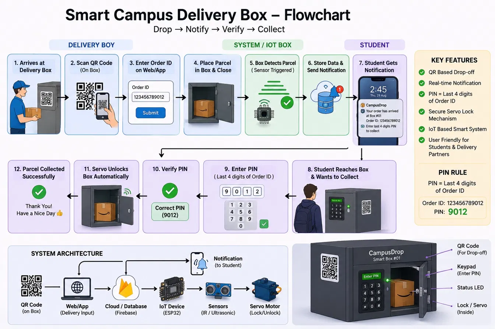

# CampusDrop — Smart Campus Delivery Box System

An IoT-powered smart locker parcel delivery and pickup platform designed for university campuses and colleges. Built to streamline parcel logistics:



**Live web app:** https://campus-drop-zeta.vercel.app/ (may change over time)

## 🚀 Key Features

- **Separate Role Portals**:
  1. 🚚 **Delivery Boy Portal** (`#/deliver`): QR scan of the box, numeric Order ID input, automatic pickup PIN generation, student lookup, parcel size selection, and a guided 4-step drop flow that unlocks and locks the real box.
  2. 🎓 **Student Pickup Portal** (`#/collect`): Pending parcels, at-box QR check, then the PIN is typed on the **box's physical keypad** and mirrored live on the page. The servo unlocks automatically when the PIN is right.
  3. 🖥️ **Admin / Campus Overview Dashboard** (`#/dashboard`): Interactive Three.js 3D locker wall, live device event log, remote unlock, weekly volume chart, and searchable order records.
- **PIN Rule**:
  - The Pickup PIN is strictly the **last 4 digits of the Order ID** (e.g. Order `123456789012` &rarr; PIN `9012`).
- **Real-Time Notifications**:
  - When a parcel is registered, every open copy of the website shows a phone-style notification banner with a chime. SMS will be added later.
- **One real box, five simulated**:
  - **Box 01** is the physical box (ESP8266 + Arduino UNO). **Boxes 02–06** are simulated in the browser.
  - In Firebase mode Box 01 shows **Online** only while the ESP8266 is sending its heartbeat (every 10 s, marked offline after 30 s without one). Until the hardware connects it shows **Offline** with "No heartbeat".
- **Two modes**:
  - **Firebase mode**: when `firebase-config.js` has a real `databaseURL`, orders, box state and device events sync live through **Firebase Realtime Database** across all devices and the real box. The page header shows **Live / Firebase**.
  - **This device only**: with no Firebase config (`databaseURL` empty or containing `YOUR_`), everything runs in the browser (`localStorage`) and all six boxes are simulated, so Box 01 always looks online.

## 📁 Project Structure

```
campus drop/
├── index.html                       # Web app (all portals & 3D visualizer)
├── firebase-config.js               # Firebase web config (databaseURL + projectId)
├── database.rules.json              # Realtime Database rules
├── firebase.json                    # Firebase Hosting + database config
├── server.js                        # Small local web server (npm start)
├── image.png                        # System flowchart
├── report-figures/                  # Figures used in the project report
└── firmware/
    ├── esp8266_campusdrop/          # ESP8266: WiFi, Firebase, keypad
    │   ├── esp8266_campusdrop.ino
    │   ├── secrets.example.h        # Template for your WiFi login
    │   └── secrets.h                # Your WiFi login (git-ignored, you create it)
    ├── uno_campusdrop/              # Arduino UNO: servo, HC-SR04, 16x2 I2C LCD
    └── HARDWARE_GUIDE.md            # Wiring, flashing, calibration, troubleshooting
```

---

## 🔥 Firebase Setup (one time)

The site only uses the **Realtime Database**. It needs no sign-in, Authentication, App Check or service account.

1. Go to [console.firebase.google.com](https://console.firebase.google.com) and create a project.
2. **Build → Realtime Database → Create database** (pick the location closest to you, e.g. Singapore).
3. In the database's **Rules** tab, paste the contents of `database.rules.json` and publish. Do not rely on "test mode": it stops working after 30 days.
4. Copy the **database URL** from the top of the Data tab (e.g. `https://<project>-default-rtdb.<region>.firebasedatabase.app`) and your project ID into `firebase-config.js`:
   ```js
   window.CAMPUSDROP_FIREBASE = {
     databaseURL: "https://<project>-default-rtdb.<region>.firebasedatabase.app",
     projectId: "<project>"
   };
   ```
   The other web-app values (`apiKey`, `appId`, …) are optional and only needed if you later add Firebase Authentication or other services.
5. Put the same database host (without `https://` and without a trailing `/`) into `FIREBASE_HOST` in `firmware/esp8266_campusdrop/esp8266_campusdrop.ino`, then re-flash the ESP8266.

> ⚠️ The included rules allow anyone with the database URL to read and write, and the URL is public in `firebase-config.js`. That's fine for a prototype demo, but lock the database down before real use. The pickup PIN (last 4 digits of the order ID) is also easy to guess.

---

## 📱 Mobile App (`mobile/`)

An Expo / React Native app (Android + iOS) that talks to the same Firebase Realtime Database as the website and the box.

- **Pickup**: choose your student profile, see waiting parcels, get an in-app alert + vibration when one arrives, and collect with the PIN (live keypad mirror for Box 01, on-screen keypad for simulated boxes).
- **Deliver**: register a parcel; the app unlocks the box, waits for the drop, locks it and notifies the student.
- **Boxes**: live online/free/occupied status and remote lock/unlock for Box 01.

```bash
cd mobile
npm install
npx expo start      # scan the QR code with the Expo Go app
```

The database URL lives in `mobile/src/db.js` (keep it in sync with `firebase-config.js`).

---

## 🏃 Quick Start

```bash
npm install
npm start
```

Open 👉 **`http://localhost:3000`**. The top of the page shows **Live / Firebase** when Firebase is connected, or **This device only** when it isn't.

### Deploying

The live site is hosted on **Vercel** (see the link at the top). `firebase.json` is also set up if you prefer Firebase Hosting:

```bash
npx firebase-tools login
npx firebase-tools deploy --only hosting,database
```

---

## 🔌 Hardware (Box 01)

See [`firmware/HARDWARE_GUIDE.md`](firmware/HARDWARE_GUIDE.md) for full wiring, flashing, and calibration.

Before flashing the ESP8266, copy `firmware/esp8266_campusdrop/secrets.example.h` to `secrets.h` in the same folder and enter your 2.4 GHz WiFi name and password. `secrets.h` is git-ignored, so your password is never committed.

| Part | Board | Pins |
|---|---|---|
| 4×4 keypad | ESP8266 | Rows D1, D3, D4, D5 · Cols D6, D7, D8, D0 |
| SG90 servo | UNO | D9 (0° locked, 90° unlocked) |
| HC-SR04 ultrasonic | UNO | TRIG D7, ECHO D6 |
| 16×2 I2C LCD | UNO | SDA A4, SCL A5 |
| UNO ↔ ESP8266 serial | both | UNO TX → 1k/2k divider → ESP RX, ESP TX → UNO RX, common GND |

---

## 🗄️ Firebase Data

| Path | Written by | Contents |
|---|---|---|
| `orders/{orderId}` | website, ESP8266 | student, box, courier, size, `pin`, `status` (`awaiting` / `collected`), `attempts`, timestamps |
| `boxes/B01` | ESP8266, website | `lastSeen` heartbeat, `locked`, `servoAngle`, `parcelPresent`, `distanceCm`, `keypad` (digits typed so far), `currentOrder` |
| `boxes/B01/command` | website | `{ action: "unlock" \| "lock", id }`. The ESP8266 runs it and writes `commandAck = id` |
| `events/{id}` | website, ESP8266 | device log shown on the dashboard |
(Just a prototype idea)